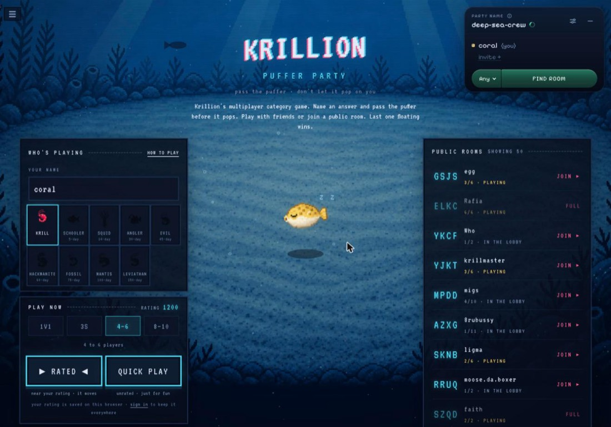
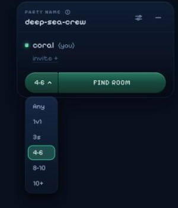
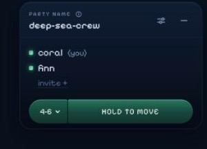
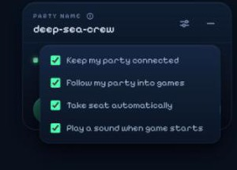

# Krillion Puffer Party With Friends


A small Chrome extension so you and your friends land in the **same**
Puffer Party room on [krillion.io](https://krillion.io/party).

One of you joins a room. Everyone else gets pulled in automatically.
No shouting a code over Discord, no typing, no clicking.

<br clear="right">



---

## The problem it fixes

Puffer Party's **Quick Play** puts you in the fullest lobby it can find. That is
good for the game — rooms fill up fast — and terrible for friends, because the
fullest lobby usually has exactly **one** seat left.

So you press Quick Play together and get split up. Every time.

This extension gives you a shared "party". When one of you goes into a room,
the others follow into that same room, in the same second.

---

## Install it (each person does this once)

You both need it installed. It takes about a minute.

1. **Download** the latest `krillion-party-joiner-x.y.z.zip` from
   [Releases](../../releases), and unzip it.
2. Open **`chrome://extensions`** in your browser.
3. Turn on **Developer mode** (top right).
4. Click **Load unpacked** and pick the folder you just unzipped.
5. Go to [krillion.io/party](https://krillion.io/party). A panel appears in the
   top right corner.

> Works in Chrome and other Chrome-based browsers (Edge, Brave, Arc, Dia).

---

## Use it

### 1. Agree on a party name

Type the **same name** on every machine. That is the whole setup — the name is
what links you together.

Pick something nobody would guess, like `deep-sea-crew-4417`. Anyone who types
your party name joins your party, so treat it a bit like a password.

A spinner appears while it connects, then a tick. Your friend shows up in the
list the moment they type the same name.

### 2. Play normally

Join a room however you like — the public list, **Join by code**, **Quick Play**,
**Rated**, or by hosting your own. Your friends are pulled in behind you.

They do not have to click anything. Their browser opens the room and presses
**Take a seat** for them.

### 3. Or let it find a room for you



Press **Find room** and it reads the live room list and picks a lobby with
enough free seats for everyone in your party — then takes you all there.

Use the size button on the left to say what kind of game you want:
**Any**, **1v1**, **3s**, **4-6**, **8-10** or **10+**.

<br clear="right">

### Once you are all in together



The button changes to **Hold to move** and needs a four-second press.

That is on purpose. Once you have all got seats, one stray click should not
drag everybody back out of the room you just filled.

<br clear="right">

---

## Settings



Click the sliders icon in the panel's header.

- **Keep my party connected** — turn the whole thing off for a bit
- **Follow my party into games** — go where they go
- **Take seat automatically** — press Take a seat for you on arrival
- **Play a sound** — a short blip when a friend turns up or you get pulled in

<br clear="right">

---

## What it sends, and where

Short version: **a four-letter room code, and nothing else.**

Your browsers talk to each other through a free public MQTT message broker
(`broker.hivemq.com`, falling back to `test.mosquitto.org`). The "channel" they
talk on is your party name.

What travels: the room code, your Krillion display name, and whether you have
following switched on. That is the entire message.

What does **not**: no account, no login, no email, no analytics, no tracking,
and nothing is stored on any server. There is no account to make.

Because the broker is public, anyone who guesses your party name could see your
room codes and join your games. That is the only reason to pick an unusual name.

---

## If something is not working

**Nothing happens when my friend joins a room.**
Check you have typed exactly the same party name, character for character. Open
the panel on both machines and make sure you can each see the other's name.

**It opens the room but I am not in the game.**
Krillion will not seat you until you have typed a display name under **YOUR
NAME** on its page. Do that once and it sticks.

**It says Krillion wants a quick verification.**
That is Cloudflare, and only you can tap it. The extension waits for you.

**Something else.**
Click the status line at the bottom of the panel, or press **Alt+L**. That copies
a log of what happened, with your party name masked, ready to paste into an issue.

---

## For developers

Plain JavaScript and CSS. No build step, no dependencies, no framework.

```
extension/
  manifest.json    Chrome MV3 manifest
  content.js       the whole panel: UI, presence, relay, auto-seat
  content.css      styles and the two fonts, inlined as data URIs
  background.js    one job: fetch the public room list (CORS)
  popup.html/js    the toolbar shortcut
tools/
  panel-states.html  every UI state, side by side  →  open it, it is useful
  panel-states.js    the state table behind that page
  panel-frame.html   renders one state: panel-frame.html?s=together
  embed-fonts.py     re-inlines the woff2 files into content.css
  pack.sh            builds krillion-party-joiner-<version>.zip
docs/img/          the screenshots in this README
RESEARCH.md        how Krillion's party backend actually works
```

**Run the state gallery**, which renders the real stylesheet so it cannot drift
from the extension:

```bash
python3 -m http.server 8787
```

Then open `http://localhost:8787/tools/panel-states.html`.

**Build a zip:**

```bash
./tools/pack.sh
```

A few things worth knowing before you change anything:

- The relay is hand-rolled MQTT 3.1.1 over a WebSocket, about 30 lines in
  `content.js`. No library ships with the extension. It replaced
  [ntfy.sh](https://ntfy.sh), which has a ~250 message/day cap this blew through
  in hours.
- The fonts are **inlined as data URIs**. A `chrome-extension://` font referenced
  from a content script's stylesheet does not load on krillion.io, even listed in
  `web_accessible_resources`. Run `tools/embed-fonts.py` after changing them.
- `content.js` is a single IIFE on purpose — content scripts have no module
  loader and this needs no bundler.

---

## Licence

[MIT](LICENSE).

Pixelify Sans and VT323 are bundled under the
[SIL Open Font License 1.1](https://openfontlicense.org/).

Not affiliated with Krillion. It clicks the same buttons you would, and nothing else.
